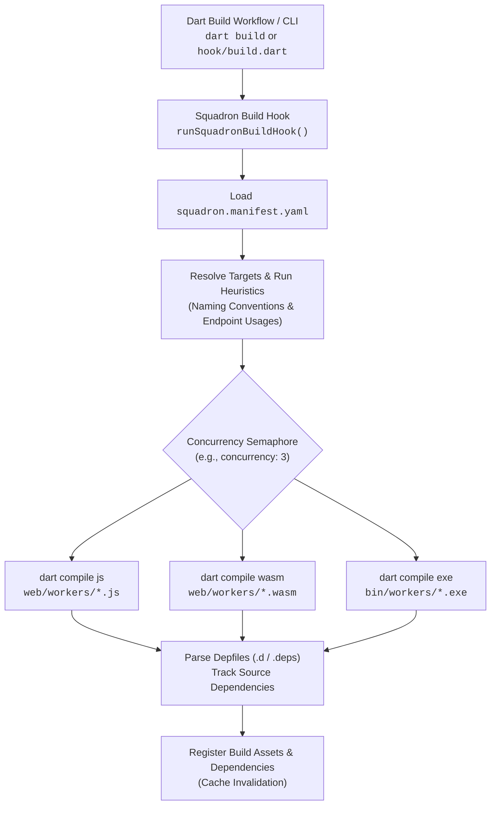

<table><tr>
<td valign="top">
  
</td>
<td>

## **squadron_build_hook - Automated Dart Build Hook for Squadron Workers**

Automate compilation of Squadron worker entry points during your application's build process!  
Seamlessly targets **Browser** (JS & WASM) and **Desktop/Server** (Native executables).

[Quick Start](#getting_started) • [Why squadron_build_hook?](#why-squadron_build_hook) • [Manifest Configuration](#manifest) • [Smart Heuristics](#heuristics) • [Squadron Repository](https://github.com/d-markey/squadron)

[](https://pub.dev/packages/squadron_build_hook)
[](https://pub.dev/packages/squadron_build_hook)
[](https://pub.dev/packages/squadron_build_hook)

[](https://pub.dev/packages/squadron_build_hook/score)
[](https://pub.dev/packages/squadron_build_hook/score)
[](https://pub.dev/packages/squadron_build_hook/score)
[](https://github.com/d-markey/squadron_build_hook/blob/main/LICENSE)
[](https://dart.dev/null-safety)
[](https://pub.dev/packages/lints)

[](https://github.com/d-markey/squadron_build_hook/commits)
[](https://github.com/d-markey/squadron_build_hook/actions/workflows/dart.yml)

</td>
</tr></table>

---

## 🚀 Why squadron_build_hook?

[Squadron][pub_squadron] brings robust multithreading and worker pooling to Dart, targeting both native isolates/processes and web platforms (JavaScript & WebAssembly). However, web workers and IPC process workers require dedicated compilation steps (`dart compile js`, `dart compile wasm`, or `dart compile exe`).

Historically, developers had to manually orchestrate compilation scripts or build commands before packaging or testing their apps.

**squadron_build_hook** solves this by integrating natively into Dart's build hook system (`package:hooks` and `package:code_assets`):

* ⚡ **Zero-Friction Builds**: Automatically compiles worker entry points during `dart build`, `dart test`, or your custom build pipelines.
* 🎯 **Multi-Platform Support**: Compiles workers to JavaScript (`js`), WebAssembly (`wasm`), and standalone native binaries (`exe`).
* 🧠 **Diagnostic-Driven Heuristics**: Automatically infers and resolves worker companion entry points (`.web.g.dart`, `.vm.g.dart`, or scripts calling `runWorkerService` / `runWorkerProcess`) with ambiguity detection.
* 📦 **Declarative Manifest (`squadron.manifest.yaml`)**: Centralize your worker compilation definitions, output paths, and compiler flags.
* ⏱️ **Fast Incremental Builds**: Tracks compilation dependencies via `.d` and `.deps` files, invalidating build caches only when relevant source files change.
* 🚦 **Concurrency Management**: Regulates parallel compiler execution with built-in concurrency controls.
* 💻 **Standalone CLI Mode**: Execute worker compilations independently via CLI without triggering a full application build.

> [!WARNING]
> **Experimental Status & Dart Build Hooks**  
> Dart's native build hook ecosystem (`package:hooks` and Native Assets) is relatively recent and still evolving. As a result, **squadron_build_hook** is currently **experimental**. Manifest specifications, hook behavior, and companion tooling may evolve as Dart's build hook architecture matures. Feedback and contributions are welcome!

---

## 🏗️ Architecture



---

## 📖 Table of Contents
- [Getting Started](#getting_started)
- [Hook Setup (`hook/build.dart`)](#hook_setup)
- [Manifest Configuration (`squadron.manifest.yaml`)](#manifest)
  - [Basic Worker Definition](#basic_worker)
  - [Named Output Groups](#named_outputs)
  - [Named Shared Defines](#named_defines)
  - [Inline Defines & Optimization Levels](#defines_and_opts)
- [Smart Target Heuristics](#heuristics)
  - [By Naming Conventions](#heuristics_naming)
  - [By Endpoint Usage](#heuristics_endpoints)
- [Standalone CLI Build](#standalone)
- [Troubleshooting & Diagnostics](#diagnostics)
- [Community & Credits](#credits)

---

## <a name="getting_started"></a>1. Getting Started

Add **[squadron_build_hook][pub_squadron_build_hook]** to your `dev_dependencies` in `pubspec.yaml`:

```yaml
dependencies:
  squadron: ^7.4.0

dev_dependencies:
  squadron_build_hook: ^0.1.0
  squadron_builder: ^9.0.0 # for code generation
  build_runner:
```

Run `dart pub get` to install.

---

## <a name="hook_setup"></a>2. Hook Setup (`hook/build.dart`)

To leverage Dart's native build hook architecture, create a `hook/build.dart` file in the root of your project:

```dart
// file: hook/build.dart
import 'package:squadron_build_hook/squadron_build_hook.dart';

void main(List<String> args) async =>
    await runSquadronBuildHook(args, concurrency: 3);
```

Whenever Dart runs a build task that invokes hooks, `squadron_build_hook` will read your manifest, locate worker entrypoints, compile them in parallel (regulated by `concurrency`), and register the resulting assets and dependency tree for incremental caching.

---

## <a name="manifest"></a>3. Manifest Configuration (`squadron.manifest.yaml`)

Define your workers in `squadron.manifest.yaml` (or `squadron.manifest`) in your project's root folder.

### <a name="basic_worker"></a>Basic Worker Definition

You can specify the worker service source and which compilers to target (`js`, `wasm`, `exe`):

```yaml
workers:
  # Web worker compiled to both JS and WASM
  - source: lib/src/workers/parser_service.dart
    targets:
      - compiler: js
        output: web/workers/parser_service.js
      - compiler: wasm
        output: web/workers/parser_service.wasm

  # Process-based sidecar worker compiled to standalone binary
  - source: lib/src/workers/compute_service.dart
    targets:
      - compiler: exe
        output: bin/workers/compute_service.exe
```

> [!TIP]
> If `output` is omitted, `squadron_build_hook` automatically infers a sensible default path:
> * `js` &rarr; `web/workers/<source_name>.js`
> * `wasm` &rarr; `web/workers/<source_name>.wasm`
> * `exe` &rarr; `bin/workers/<source_name>.exe`

### <a name="named_outputs"></a>Named Output Groups

You can define reusable output directory presets under the top-level `outputs` section:

```yaml
outputs:
  tests:
    - compiler: js
      output: test/workers/js
    - compiler: wasm
      output: test/workers/wasm

workers:
  - source: test/worker_services/cache_service.dart
    outputs: tests
    targets:
      - compiler: js
      - compiler: wasm
```

### <a name="named_defines"></a>Named Shared Defines

Similar to `outputs`, you can define top-level reusable `defines` presets and reference them by name in workers or targets:

```yaml
defines:
  prod:
    # Automatically passed as -Dsquadron.no_internal_logging=true
    no_internal_logging: true
    env: production
  dev:
    debug: true

workers:
  # Uses the shared 'prod' defines preset
  - source: lib/src/workers/analytics_service.dart
    defines: prod
    targets:
      - compiler: js
        optimization-level: 4 # number or string
      - compiler: wasm
        defines:
          # Worker 'prod' defines are inherited and merged with target-specific defines
          enable_simd: true

  # Combines a shared preset with inline custom defines
  - source: lib/src/workers/data_service.dart
    defines:
      - dev
      - custom_key: custom_value
```

### <a name="defines_and_opts"></a>Inline Defines & Optimization Levels

You can also pass inline custom Dart defines and compiler optimization levels directly per target or per worker (`optimization-level` accepts either a number like `4` or a string like `'4'`):

```yaml
workers:
  - source: lib/src/workers/analytics_service.dart
    defines:
      # Automatically prefixed as -Dsquadron.production=true
      production: true
      enable_profiling: false
    targets:
      - compiler: js
        optimization-level: 4 # number or string
      - compiler: wasm
        optimization-level: 2
```

---

## <a name="heuristics"></a>4. Smart Target Heuristics

`squadron_build_hook` is designed to minimize configuration boilerplate. When targets or entrypoint source paths are omitted, it automatically scans and resolves candidate files containing `main()` functions:

### <a name="heuristics_naming"></a>1. Naming Conventions Heuristic
Discovers generated entrypoints based on standard Squadron builder patterns:
* **Web Entrypoints**: `<worker>.web.g.dart`, `<worker>.g.dart`
* **VM / IPC Entrypoints**: `<worker>.vm.g.dart`, `<worker>.g.dart`, `<worker>.dart`
* Automatically resolves cross-directory naming pairings (e.g. `lib/src/services/*_service.dart` paired with `bin/workers/*_worker.dart`).

### <a name="heuristics_endpoints"></a>2. Endpoint Usage Heuristic
Scans workspace Dart files for Squadron runner invocations:
* Files invoking `runWorkerService(...)` are automatically identified as Web Worker entrypoints.
* Files invoking `runWorkerProcess(...)` are automatically identified as Process Sidecar entrypoints.

> [!IMPORTANT]
> If heuristics detect multiple conflicting candidate files for a single compiler target, the hook marks the target as ambiguous, warns you in the log output, and skips compilation of that ambiguous target until explicitly configured in the manifest.

---

## <a name="standalone"></a>5. Standalone CLI Build

Need to compile your workers without running a full build hook? Use the standalone executable:

```bash
# Run standalone worker compilation in current directory
dart run squadron_build_hook:standalone_build

# Or specify a target project folder
dart run squadron_build_hook:standalone_build /path/to/my_project
```

You can also invoke it programmatically in your own Dart tools:

```dart
import 'package:squadron_build_hook/squadron_build_hook.dart';

void main() async {
  await runStandalone(concurrency: 4);
}
```

---

## <a name="diagnostics"></a>6. Troubleshooting & Diagnostics

If an entrypoint is not compiling as expected:

1. **Verify `main()` entrypoint**: Standalone executables and web workers require a top-level `void main()` entrypoint function.
2. **Review Ambiguity Warnings**: If a worker has multiple matching companion files, specify the explicit `source:` under `targets:` in your `squadron.manifest.yaml`.
3. **Inspect Output Depfiles**: Generated `.deps` (for JS) and `.d` (for WASM and EXE) show the exact dependency tree tracked for incremental compilation.

---

## <a name="credits"></a>Community & Credits

* **[Squadron][pub_squadron]**: Multithreading and worker pooling framework for Dart & Flutter.
* **[squadron_builder][pub_squadron_builder]**: Code generator for Squadron service workers and pools.
* Author: [David MARKEY](https://github.com/d-markey)
* License: [MIT License](LICENSE)

---

[pub_squadron]: https://pub.dev/packages/squadron
[pub_squadron_builder]: https://pub.dev/packages/squadron_builder
[pub_squadron_build_hook]: https://pub.dev/packages/squadron_build_hook
